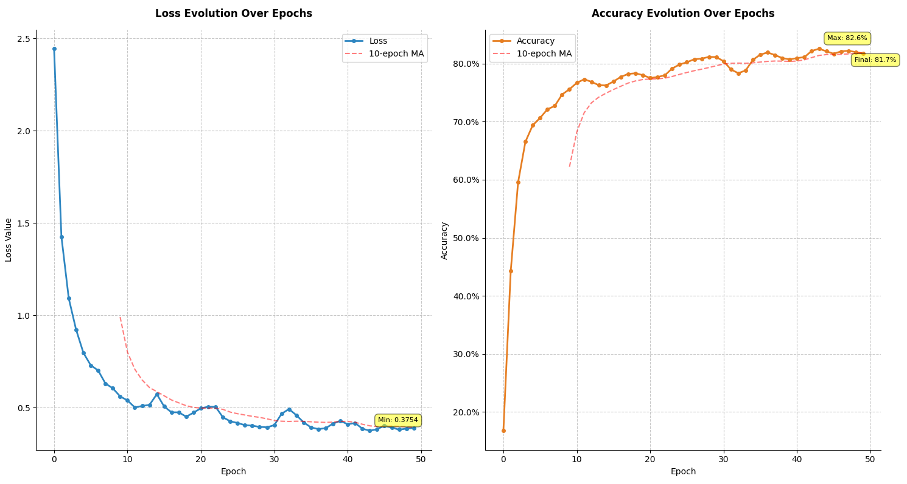
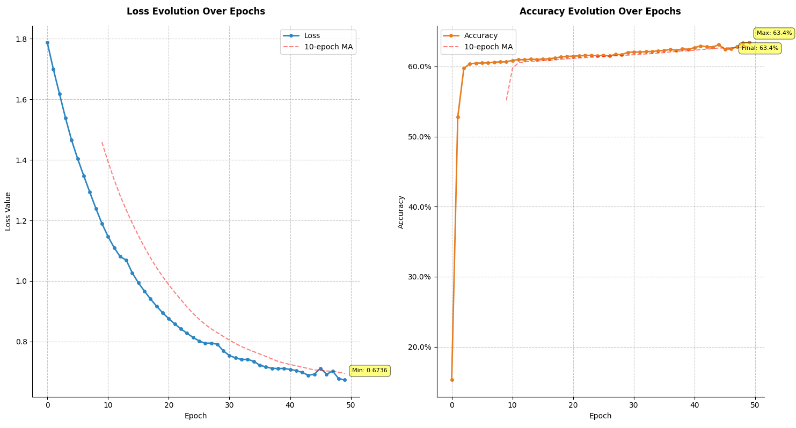
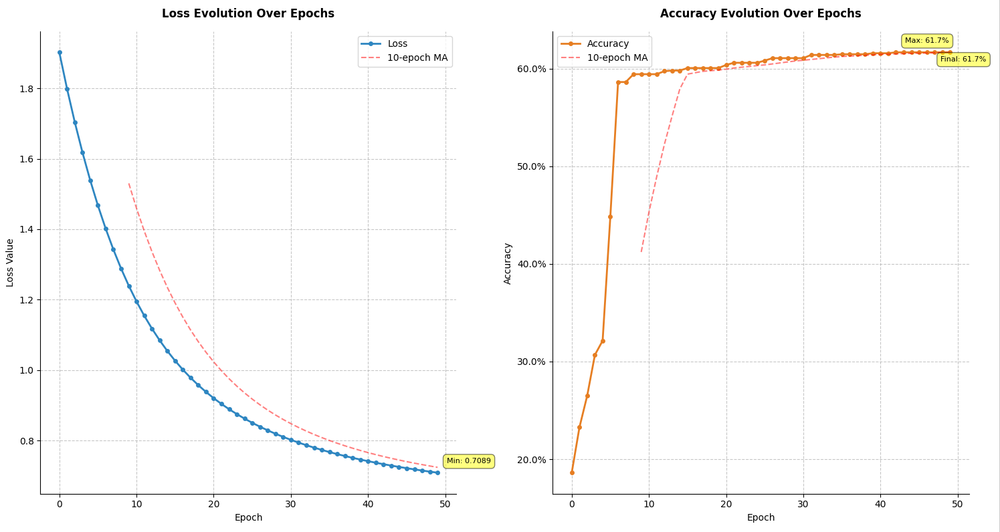
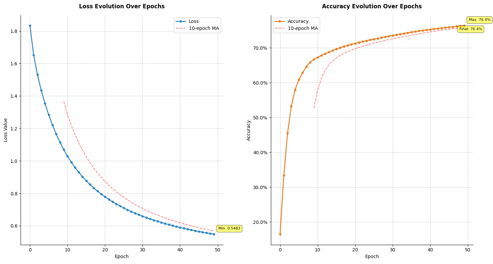
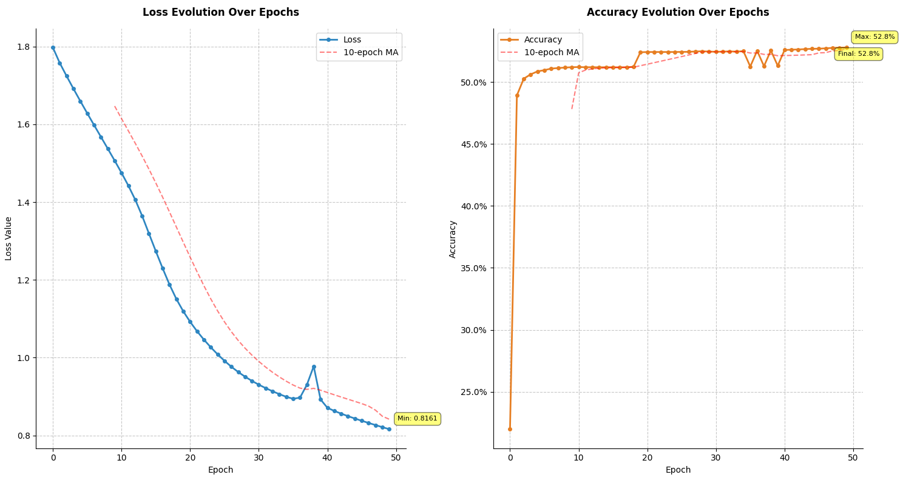
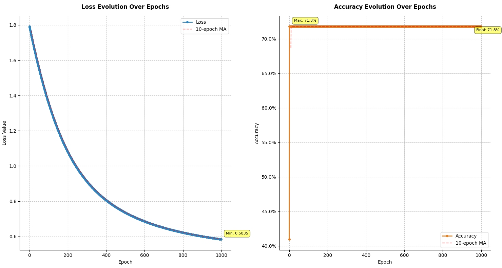
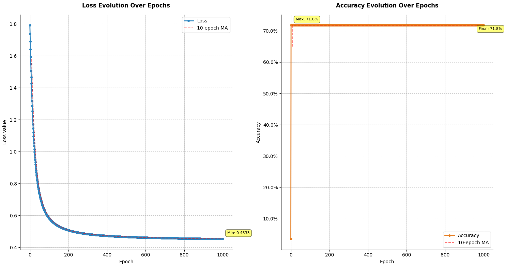
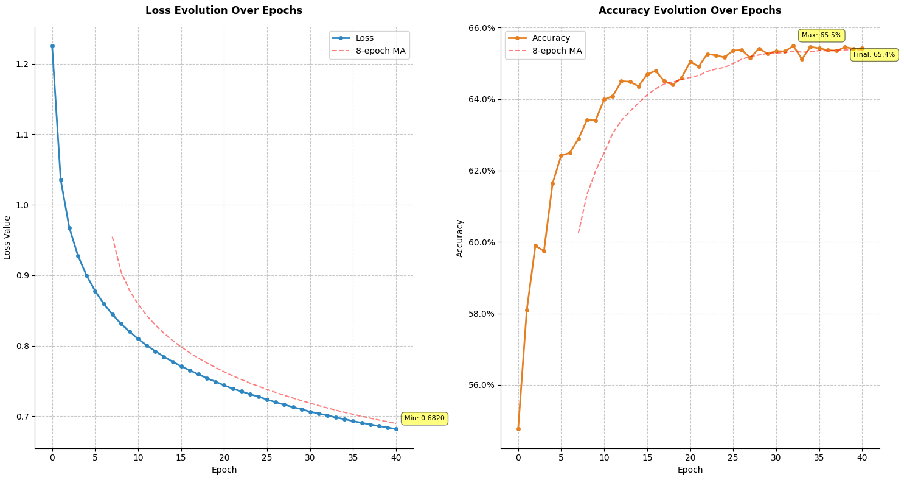
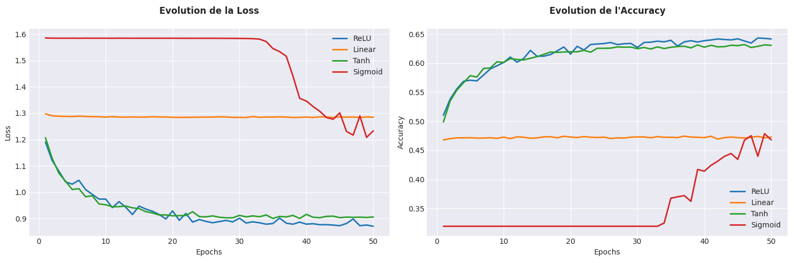

#  My_Torch - A Clash of Kings

This project involves the creation of two binaries that work together to simulate chess-based strategies using machine learning techniques. The goal is to generate and train neural networks that can analyze chessboard states and determine the current game status, including checkmate, check, stalemate, or nothing. Additionally, optimization techniques, proper error handling, and professional documentation are required.

## Binaries Overview

The project consists of two main binaries:

1. **Neural Network Generator (`my_torch_generator`)**: This binary generates neural networks based on configurations defined in a configuration file.
2. **Chessboard Analyzer (`my_torch_analyzer`)**: This binary can be launched in either training mode or prediction mode to train or test the neural network using chessboards in Forsyth–Edwards Notation (FEN).

## Requirements

- The project must use supervised learning for training neural networks.
- Libraries handling neural networks, such as PyTorch or TensorFlow, are **NOT allowed**.
- A pre-trained neural network should be provided with the project, starting with the name "my_torch_network".
- Your project should include professional documentation, including benchmarks and design choices.

---

## 1. **Neural Network Generator (`my_torch_generator`)**

The generator creates neural networks from configuration files. You can specify one or more configuration files and the number of neural networks to generate.

### Usage:
```bash
./my_torch_generator --help
```

```bash
./my_torch_generator config_file_1 nb_1 [config_file_2 nb_2...]
```

- (`config_file_i`)is the configuration file for the neural network.
- (`nb_i`) is the number of networks to generate from that configuration file.

### Exemple:
```bash
    # Exemple of configuration file
    input_size=64
    hidden_layers=256,128,64
    output_size=6
    learning_rate=0.01
    epochs=100
    batch_size=32
    activations_functions=relu,relu,relu,softmax
```
```bash
./my_torch_generator basic_network.conf 3
```
## 2. **Chessboard Analyzer (`my_torch_analyzer`)**
This analyzer can be launched in two modes:

    - Train Mode: To train the neural network using chessboard data.
    - Predict Mode: To make predictions about the state of the chess game.

```bash
./my_torch_analyzer --help
```
Shows the following usage options:

    --train : Launches training mode, training the neural network.
    --predict : Launches prediction mode, analyzing chessboards.
    --save SAVEFILE : Optionally saves the trained network to a specific file (only in train mode).

### Predict Mode:

```bash
./my_torch_analyzer --predict my_torch_network_basic.nn DATASET/
```
### Train Mode:
```bash
./my_torch_analyzer --train --save my_torch_network_trained.nn DATASET/
```
This will train a neural network on the chessboards provided in (`DATASET/`) and save the trained network to (`my_torch_network_trained.nn`).

## Our models
### Performances


Benchmark with linear function on 50 Epoch.



Benchmark with ReLu function on 50 Epoch.



Benchmark with Sigmoid function on 50 Epoch.



Benchmark with Tanh function on 50 Epoch.



Benchmark by shuffling datasets on 50 Epoch.



Benchmark with 7 hidden layers and 0.01 learning rate on 1000 Epoch.



Benchmark with 7 hidden layers and 0.1 learning rate on 1000 Epoch.



Benchmark of our model on 40 Epoch.



Benchmark of every function.

Finally, the best model uses the relu activation function with 0.01 learning rate with layers 256,128,64,32,16,8,4.
